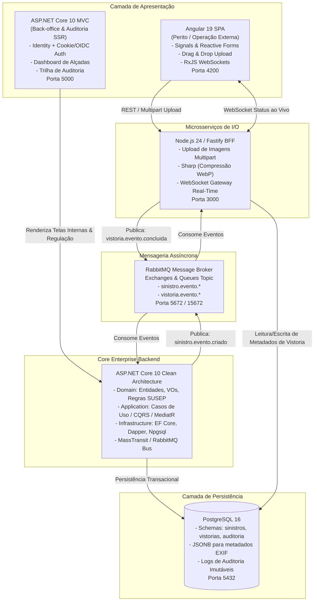

#  Plataforma de Gestão de Sinistros e Vistorias
> **Arquitetura Corporativa Orientada a Eventos (Enterprise & Event-Driven Architecture)** para regulação de sinistros automotivos, vistorias técnicas periciais e esteira de aprovação de alçadas regulatórias.

[](https://github.com/LuizhBrandao/GestaoSinistrosVistorias/actions/workflows/ci.yml)

-DD0031?style=flat&logo=angular&logoColor=white)

-4169E1?style=flat&logo=postgresql&logoColor=white)


-green?style=flat)

---

##  Visão Executiva do Projeto

Projetada como uma **solução de missão crítica do setor financeiro e segurador (Insurtech & Banking)**, a plataforma resolve os três principais gargalos operacionais da regulação de sinistros de veículos:
1. **Lentidão e Fraude na Coleta de Evidências em Campo:** Peritos utilizam uma **SPA Angular reativa com Signals** integrada a um **BFF Node.js/Fastify** que realiza compressão automática em **WebP (redução de ~75% no tráfego)**, validação de integridade criptográfica **SHA-256** e checagem de geolocalização **GPS (anti-fraude)**.
2. **Desacoplamento e I/O Intensivo:** A comunicação entre o envio de fotos periciais e o motor de decisão financeira é **100% assíncrona via RabbitMQ**, evitando travamentos ou consumo indevido de conexões de banco de dados.
3. **Motor de Regras Regulatório (SUSEP) & Auditoria:** O núcleo corporativo em **.NET 10 (Clean Architecture & Tactical DDD)** calcula automaticamente a classificação entre **Perda Parcial vs. Perda Total** (regra dos 75% da Tabela FIPE), direciona o processo na **esteira de alçadas de autoridade** (Operacional, Supervisão, Gerencial e Diretoria) e registra cada transição em uma **Trilha de Auditoria Imutável**.

---

##  Arquitetura da Solução (C4 Container & Event-Driven)



---

##  Decisões de Arquitetura (ADRs)

| Componente | Decisão Técnica | Justificativa Arquitetural |
| :--- | :--- | :--- |
| **Back-Office Corporativo** | **.NET 10 MVC (SSR)** | A regulação de sinistros envolve decisões financeiras de alto valor e conformidade regulatória. O Server-Side Rendering no .NET 10 oferece máxima segurança contra manipulações no cliente, autenticação corporativa robusta (Cookies/OIDC) e performance nativa para transações financeiras. |
| **Operação de Vistoria** | **Angular 19 (SPA)** | Peritos em oficinas e pátios necessitam de uma interface rica, reativa e dinâmica para preenchimento de checklists de avarias por peças. O uso de **Angular Signals** fornece somatórios reativos imediatos sem a sobrecarga do ciclo padrão de detecção de mudanças. |
| **BFF & Worker de Mídia** | **Node.js (Fastify + Sharp)** | O upload de imagens de alta resolução (20-30 MB) geraria gargalos de thread pool no backend transacional. O Fastify com streaming multipart e o Sharp convertem as fotos para WebP de forma não bloqueante com baixíssimo consumo de memória. |
| **Mensageria Assíncrona** | **RabbitMQ** | Garante o desacoplamento temporal: a submissão de um laudo pericial nunca trava o perito esperando cálculos de seguros ou atualizações de banco de dados corporativo. |
| **Isolamento de Dados** | **PostgreSQL Multi-Schema** | O banco relacional possui schemas independentes (`sinistros`, `vistorias` e `auditoria`), refletindo os Bounded Contexts do DDD diretamente na camada de persistência. |

---

##  Regras de Negócio e Governança DDD

1. **Classificação Regulatória de Perda (Normas SUSEP):**
   - **Perda Total (Indenização Integral):** Ocorre se o custo do orçamento de peças e mão de obra for $\ge 75\%$ do valor da Tabela FIPE do veículo. Indeniza-se **100% da FIPE sem dedução de franquia**.
   - **Perda Parcial:** Se o orçamento for $< 75\%$ da FIPE, indeniza-se o **custo total orçado subtraído o valor da franquia contratada**.
2. **Esteira de Aprovação de Alçadas:**
   - **Operacional (Analista):** Limite de até **R$ 10.000,00** (auto-aprovação de baixo risco).
   - **Supervisão:** Limite de até **R$ 50.000,00**.
   - **Gerencial / Diretoria:** Valores superiores a **R$ 50.000,00** ou **qualquer caso de Perda Total**.
3. **Integridade Pericial Anti-Fraude:**
   - Todo laudo exige fotos obrigatórias com extração de hash SHA-256 e validação de coordenadas GPS da captura.

---

##  Matriz de Testes Automatizados (33 Testes - 100% Passing)

| Camada | Ferramenta | Quantidade | Escopo dos Testes |
| :--- | :--- | :---: | :--- |
| **Domain (.NET 10)** | xUnit | 24 | Invariantes de agregados (`Sinistro`, `Vistoria`), Value Objects (`PlacaVeiculo`, `ValorMonetario`), limites de alçadas e regras de 75% da FIPE. |
| **Application (.NET 10)** | xUnit + NSubstitute | 5 | Command Handlers (`AbrirSinistro`, `AprovarSinistro`), validações FluentValidation e publicação de eventos de integração. |
| **BFF (Node.js)** | Node Test Runner | 1 | Pipeline de compressão Sharp, geração de thumbnails WebP e integridade SHA-256. |
| **Frontend (Angular)** | Angular Testing Suite | 3 | Reatividade de Signals no checklist de peças e detecção automática de Perda Total. |

---

##  Setup em Um Comando (`docker compose up -d`)

O projeto está configurado para subir o ecossistema completo com **dados de demonstração já pré-carregados (Seed Data)**:

```bash
docker compose up -d
```

### Portais e Serviços Disponíveis Localmente:

| Serviço | URL | Credenciais / Notas |
| :--- | :--- | :--- |
| **Back-Office & Regulação (.NET 10)** | [http://localhost:5000](http://localhost:5000) | Dashboard de alçadas, regulação de sinistros e auditoria |
| **Portal do Vistoriador (Angular)** | [http://localhost:4200](http://localhost:4200) | SPA com Signals, checklist de peças e upload de fotos |
| **BFF & Gateway de Mídia (Fastify)** | [http://localhost:3000](http://localhost:3000) | API REST e servidor WebSocket (`/ws`) |
| **RabbitMQ Management Dashboard** | [http://localhost:15672](http://localhost:15672) | Usuário: `guest` • Senha: `guest` |
| **PostgreSQL 16 Multi-Schema** | `localhost:5432` | Banco: `sinistros_db` • Usuário: `postgres` • Senha: `postgres` |

---

##  Estrutura do Repositório

```text
├── .github/workflows/ci.yml       # Pipeline CI automatizado (3 jobs: .NET, Node, Angular)
├── docker/postgres/init.sql       # Script DDL com schemas isolados (DDD)
├── docker-compose.yml             # Orquestração local completa (Postgres, Rabbit, Backend, BFF, Frontend)
├── docs/architecture/             # Documentação técnica e Upstream DDD
│   └── 01-upstream-ddd-model.md
├── src/
│   ├── backend/                   # Solução .NET 10 Clean Architecture
│   │   ├── Sinistros.Domain/      # Entidades, Value Objects, Domain Services e Eventos
│   │   ├── Sinistros.Application/ # Casos de Uso (CQRS / MediatR) e Validações
│   │   ├── Sinistros.Infrastructure/ # EF Core, PostgreSQL, RabbitMQ e Seed Data
│   │   ├── Sinistros.Web/         # Módulo MVC Back-Office e Trilha de Auditoria
│   │   └── tests/                 # 29 Testes Automatizados com xUnit e NSubstitute
│   ├── bff-services/              # BFF Fastify, Sharp (WebP), WebSockets e RabbitMQ Worker
│   └── frontend/                  # SPA Angular 19 (Signals, Checklist Dinâmico e Upload)
└── README.md
```

---

##  Autor
**Luiz Henrique Brandão**  
*Desenvolvedor de Software focado em Arquitetura Corporativa, .NET, Angular, Node.js e Soluções Event-Driven.*
