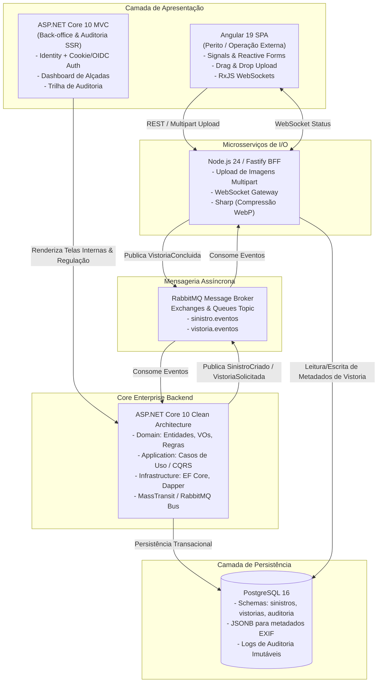

# 🚗 Plataforma de Gestão de Sinistros e Vistorias
> **Arquitetura Corporativa Orientada a Eventos (Enterprise & Event-Driven Architecture)** para regulação de sinistros automotivos, vistorias técnicas e esteira de aprovação de alçadas.

[](https://github.com/LuizhBrandao/GestaoSinistrosVistorias/actions/workflows/ci.yml)


-green?style=flat)

---

## 📌 Visão Geral do Projeto

Este projeto simula uma **solução de missão crítica do setor securitário (Insurance & Insurtech)**, projetada com rigor de governança, **Domain-Driven Design (DDD)** tático e estratégico, e **Clean Architecture**.

O sistema gerencia o ciclo completo de um sinistro automotivo:
1. **Abertura do Sinistro (*FNOL*):** Validação de apólice e dados da ocorrência.
2. **Ordem de Vistoria Técnica:** Coleta de evidências em campo com validação anti-fraude (geolocalização EXIF e fotos obrigatórias).
3. **Processamento Assíncrono de Mídia:** Compressão em segundo plano e geração de laudo pericial.
4. **Motor de Regras de Regulação:** Classificação de **Perda Parcial vs. Perda Total** (regra dos 75% da Tabela FIPE) e apuração do valor líquido indenizatório.
5. **Esteira de Governança de Alçadas:** Aprovação baseada em limites de autoridade financeira (Operacional, Supervisão, Gerencial e Diretoria) com **trilha de auditoria imutável**.

---

## 🏛️ Arquitetura da Solução (C4 Container & Event-Driven)



---

## 💡 Decisões de Arquitetura (ADRs)

| Componente | Escolha Técnica | Justificativa Arquitetural |
| :--- | :--- | :--- |
| **Back-office / Regulação** | **.NET 10 MVC (SSR)** | Focado em conformidade, auditoria e motor de regras de negócio. O Server-Side Rendering garante proteção contra manipulações no client, suporte nativo a Cookie-based Auth / OIDC e alta performance para rotinas transacionais pesadas. |
| **Operação de Campo / Vistoria** | **Angular 19 (SPA)** | Peritos em oficinas necessitam de interface rica e reativa para preenchimento de checklists dinâmicos por peças, feedback de upload de múltiplas fotos e atualização instantânea com **Signals**. |
| **BFF & Worker de Mídia** | **Node.js (Fastify + Sharp)** | Operações de I/O intensivo (upload multipart de fotos de alta resolução, extração de metadados EXIF e compressão assíncrona WebP) devem ser isoladas do backend transacional para evitar *starvation* de threads no banco de dados. |
| **Mensageria Assíncrona** | **RabbitMQ** | Garante desacoplamento temporal e resiliência. Quando o perito conclui a vistoria, o evento é enfileirado para que o motor de regulação no .NET processe o cálculo sem travar a requisição HTTP. |
| **Banco de Dados** | **PostgreSQL 16 (Multi-Schema)** | Esquemas lógicos isolados por Bounded Context (`sinistros`, `vistorias` e `auditoria`), refletindo a governança DDD diretamente no banco relacional. |

---

## 🛡️ Regras de Domínio e Governança Implementadas

1. **Classificação Regulatória de Perda (SUSEP):**
   - **Perda Total (Indenização Integral):** Ocorre se o custo do orçamento de peças e reparos for $\ge 75\%$ do valor da Tabela FIPE do veículo. Indeniza-se **100% da FIPE sem desconto de franquia**.
   - **Perda Parcial:** Se o orçamento for $< 75\%$ da FIPE, indeniza-se o **custo total orçado subtraído o valor da franquia contratada**.
2. **Esteira de Aprovação de Alçadas:**
   - **Operacional (Analista):** Limite de até **R$ 10.000,00** (auto-aprovação de baixo risco).
   - **Supervisão:** Limite de até **R$ 50.000,00**.
   - **Gerencial / Diretoria:** Valores superiores a **R$ 50.000,00** ou **qualquer caso de Perda Total**.
3. **Validação Anti-Fraude:**
   - Laudos de vistoria exigem no mínimo uma evidência fotográfica com hash SHA-256 e coordenadas GPS para poderem ser concluídos.

---

## 🚀 Como Executar Localmente (Setup em Um Comando)

### Pré-requisitos
- [Docker](https://www.docker.com/) e Docker Compose
- [.NET 10 SDK](https://dotnet.microsoft.com/)
- [Node.js 24 LTS](https://nodejs.org/)

### 1. Subir Infraestrutura (PostgreSQL + RabbitMQ)
```bash
docker compose up -d
```
* **PostgreSQL:** `localhost:5432` (Banco: `sinistros_db`, Usuário: `postgres`, Senha: `postgres`)
* **RabbitMQ Management Dashboard:** [http://localhost:15672](http://localhost:15672) (Usuário: `guest`, Senha: `guest`)

### 2. Executar os Testes Unitários de Domínio (.NET 10)
```bash
dotnet test src/backend/tests/Sinistros.Domain.Tests/Sinistros.Domain.Tests.csproj
```

---

## 📂 Estrutura do Repositório

```text
├── .github/workflows/ci.yml       # Pipeline CI automatizado com GitHub Actions
├── docker/postgres/init.sql       # Script DDL com schemas isolados (DDD)
├── docker-compose.yml             # Orquestração local de serviços
├── docs/architecture/             # Documentação técnica e Upstream DDD
│   └── 01-upstream-ddd-model.md
├── src/
│   ├── backend/                   # Solução .NET 10 Clean Architecture
│   │   ├── Sinistros.Domain/      # Entidades, Value Objects, Domain Services e Eventos
│   │   ├── Sinistros.Application/ # Casos de Uso (CQRS), DTOs e Interfaces
│   │   ├── Sinistros.Infrastructure/ # EF Core, PostgreSQL, RabbitMQ e Auditoria
│   │   ├── Sinistros.Web/         # Módulo MVC Back-Office e Governança
│   │   └── tests/                 # Testes Automatizados com xUnit
│   ├── bff-services/              # BFF e Workers Node.js (Upload e Processamento)
│   └── frontend/                  # SPA Operacional Angular 19 (Signals)
└── README.md
```

---

## 👨‍💻 Autor
**Luiz Henrique Brandão**  
*Desenvolvedor de Software focado em Arquitetura Corporativa, .NET, Angular e Soluções Event-Driven.*
