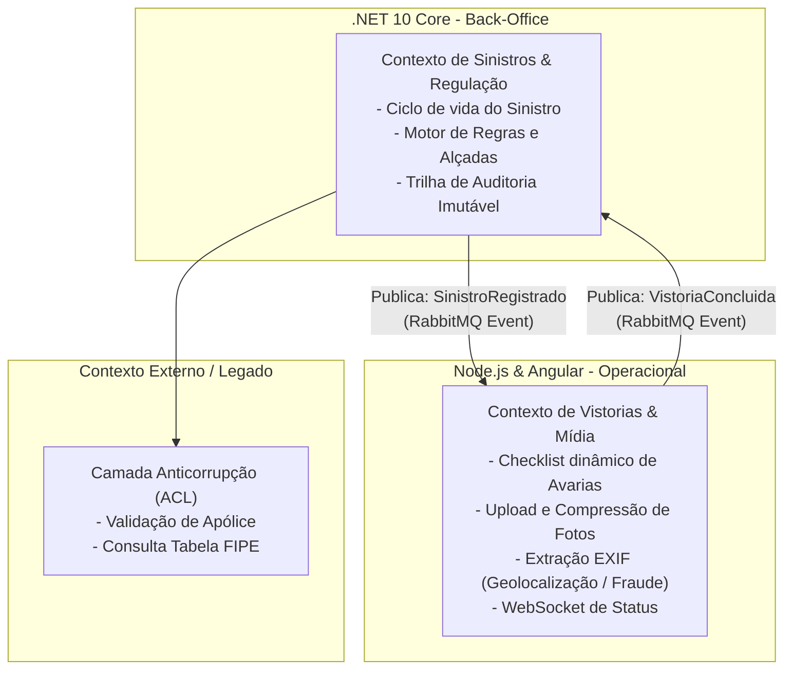
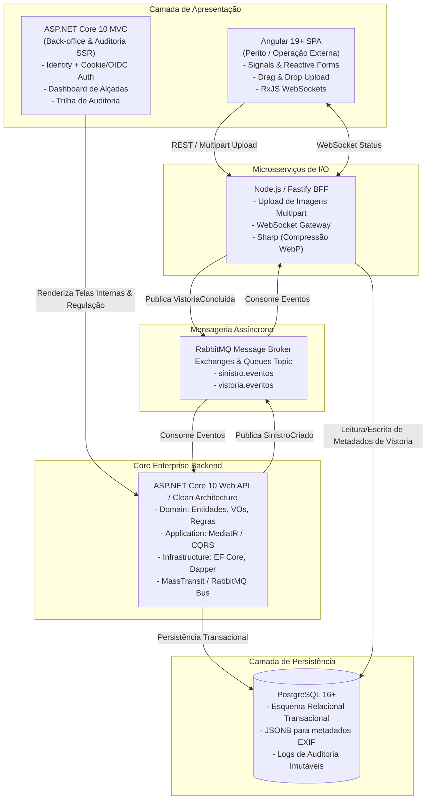

# Especificação Upstream DDD: Plataforma de Gestão de Sinistros e Vistorias

**Nicho:** Seguro Automotivo  
**Versão:** 1.0.0 (Baseline de Arquitetura)  
**Status:** Aprovado para DoR (*Definition of Ready*)

---

## 1. Diagnóstico de Riscos & Requisitos (PRD)

### 1.1 Matriz dos 4 Grandes Riscos (Marty Cagan)
* **Risco de Valor:** O segurado e a oficina necessitam de rapidez na aprovação do conserto/indenização para evitar atrasos e custos de pátio. O perito precisa de agilidade na captura de dados em campo.
* **Risco de Negócio:** Risco severo de fraude (fotos reaproveitadas, vistorias falsas, peças inexistentes) e estouro de alçadas financeiras sem auditoria rastreável.
* **Risco de Usabilidade:** Peritos em oficinas ou campo frequentemente operam sob conexões intermitentes; a experiência de formulário e upload de fotos no Angular precisa ser resiliente e assíncrona.
* **Risco Técnico:** Alto volume de I/O na submissão de imagens de alta resolução que podem degradar o sistema principal se processadas de forma síncrona; necessidade de mensageria assíncrona resiliente (RabbitMQ).

### 1.2 Personas
1. **Segurado / Terceiro:** Abre o Aviso de Sinistro (*FNOL*) com os dados básicos do acidente e apólice.
2. **Perito / Vistoriador:** Opera o painel SPA (Angular) para inspecionar o veículo, registrar avarias por peças e enviar o conjunto probatório de fotos.
3. **Analista / Regulador de Sinistros:** Opera o back-office (.NET 10) para análise de cobertura, cálculo da indenização e autorização de reparos.
4. **Gerente / Diretor de Sinistros:** Aprova alçadas superiores (valores > R$ 50.000 ou indenizações integrais / Perda Total).

### 1.3 Jornada da Solução (TO-BE)

```
[#01 Segurado] --(Comunica Acidente)--> [Aviso de Sinistro]
      │
[#02 Sistema .NET] --(Valida Cobertura & Gera)--> [Sinistro Aberto] ──(Dispara Evento RabbitMQ)──┐
                                                                                                  ▼
[#03 Node.js Worker] <----------------------------------------------------------------------------┘
      │
      └──(Cria Ordem de Vistoria e Notifica Perito)
            │
[#04 Perito no Angular] --(Preenche Checklist Dinâmico + Upload Assíncrono de Fotos)--> [Node BFF]
      │
[#05 Node.js Worker] --(Comprime Imagens + Extrai Metadados EXIF + Gera Laudo) ──(Dispara Evento)──┐
                                                                                                   ▼
[#06 Sistema .NET] <-------------------------------------------------------------------------------┘
      │
      ├──(Aplica Motor de Regras: Custo Reparo vs. 75% Tabela FIPE)
      ├──(Calcula Indenização Líquida = Reparo/FIPE - Franquia)
      │
      └──> Se Valor <= R$ 10.000: Auto-aprovação
      └──> Se Valor > R$ 10.000: Fila de Aprovação de Alçada (Supervisor/Gerente)
            │
[#07 Gestor .NET] --(Assina Digitalmente Aprovação com Trilha de Auditoria)--> [Sinistro Liquidado]
```

---

## 2. Dicionário da Linguagem Ubíqua

Terminologia rigorosa sem ambiguidades para orientar código, contratos e banco de dados:

| Termo Ubíquo | Significado no Domínio | Proibido Usar (Sinônimos Ambíguos) |
| :--- | :--- | :--- |
| **Aviso de Sinistro** (*FNOL*) | Notificação inicial do evento gerador de dano ou perda antes da análise formal. | "Chamado", "Ticket", "Reclamação" |
| **Sinistro** (*Claim*) | O processo administrativo e financeiro instaurado após validação prévia de cobertura. | "Processo", "Caso", "Protocolo" |
| **Apólice** (*Policy*) | Contrato de seguro ativo contendo coberturas contratadas, vigência e franquia. | "Contrato genérico", "Plano" |
| **Vistoria** (*Inspection*) | Procedimento técnico pericial de checagem física/remota de danos e autenticidade do veículo. | "Perícia solta", "Checkup", "Revisão" |
| **Avaria** (*Damage Item*) | Registro pontual de uma peça afetada (ex: Capô, Farol) e ação técnica recomendada (*Substituir*, *Recuperar*, *Pintura*). | "Defeito", "Problema", "Quebra" |
| **Franquia** (*Deductible*) | Participação financeira obrigatória do segurado prevista na apólice em caso de perda parcial. | "Taxa", "Coparticipação", "Multa" |
| **Tabela FIPE** (*Market Value Reference*) | Índice oficial de referência do valor de mercado do veículo na data do sinistro. | "Valor venal", "Preço de tabela" |
| **Perda Parcial** (*Partial Loss*) | Sinistro cujo orçamento de reparo é inferior a 75% do valor FIPE do veículo. | "Conserto simples" |
| **Perda Total (Indenização Integral)** (*Total Loss*) | Sinistro cujo orçamento de reparo atinge ou ultrapassa 75% do valor FIPE ou quando o veículo é furtado/roubado e não localizado. | "PT", "Perda definitiva" |
| **Alçada de Aprovação** (*Approval Threshold*) | Limite financeiro de autorização de indenização atribuído a um cargo (Analista: até R$ 10k, Supervisor: até R$ 50k, Gerente: > R$ 50k). | "Permissão genérica", "Cargo" |
| **Trilha de Auditoria** (*Audit Trail*) | Registro imutável de quem aprovou, rejeitou ou alterou valores no processo com timestamp e IP. | "Log genérico", "Histórico" |

---

## 3. Mapa de Contextos Delimitados (Context Map)



### Relação entre Contextos:
* **Sinistros & Regulação ↔ Vistorias & Mídia:** Integração 100% assíncrona orientada a eventos (*Event-Driven*) via **RabbitMQ** com schemas de mensagens tipados (*Published Language*).
* **Sinistros & Regulação ↔ Apólices/FIPE:** Integração via **Anti-Corruption Layer (ACL)**, garantindo que mudanças em APIs externas não corrompam os agregados do domínio principal.

---

## 4. Event Storming & Design Tático

### 4.1 Linha do Tempo de Eventos Pivotais & Comandos

| Fase | Comando (🟦) | Ator/Origem (🟨/🟪) | Evento de Domínio (🟧) | Agregado Responsável |
| :--- | :--- | :--- | :--- | :--- |
| **Abertura** | `RegistrarAvisoSinistro` | Segurado / API | `AvisoSinistroRegistrado` | `Sinistro` |
| **Triagem** | `ValidarCobertura` | Política Automática | `SinistroAptoParaVistoria` | `Sinistro` |
| **Vistoria** | `IniciarVistoria` | Perito (Angular) | `VistoriaIniciada` | `Vistoria` |
| **Mídia** | `ProcessarEvidenciasFotograficas` | Node.js Worker | `EvidenciasComprimidasEValidadas` | `Vistoria` |
| **Laudo** | `ConcluirVistoria` | Perito (Angular) | `VistoriaConcluida` | `Vistoria` |
| **Regulação** | `CalcularParecerTecnico` | Motor de Regras (.NET) | `ParecerIndenitorioCalculado` | `RegulacaoSinistro` |
| **Decisão** | `SubmeterParaAlcada` | Política de Valor | `AlcadaAprovacaoRequerida` | `AlcadaAprovacao` |
| **Liquidação** | `AprovarIndenizacao` | Gestor (.NET) | `SinistroAprovadoParaPagamento` | `Sinistro` |

### 4.2 Blocos de Construção DDD (Tactical Patterns)
* **Agregado `Sinistro` (Raiz: `Sinistro`):**
  * Entidade Raiz: `Sinistro` (Id, NumeroSinistro, DataOcorrencia, StatusSinistro).
  * Objetos de Valor (*Value Objects*): `NumeroApolice`, `PlacaVeiculo`, `ValorFranquia`, `ValorFipeReferencia`.
  * Invariantes de Negócio: Não permite alterar dados do sinistro após aprovação; Não permite aprovação sem laudo de vistoria concluído.
* **Agregado `Vistoria` (Raiz: `Vistoria`):**
  * Entidade Raiz: `Vistoria` (Id, SinistroId, PeritoId, StatusVistoria, DataRealizacao).
  * Entidade interna: `ItemAvaria` (Peca, TipoAcao: *Substituir/Recuperar/Pintura*, CustoEstimadoMaoDeObra, CustoPecas).
  * Objetos de Valor: `FotoEvidencia` (UrlOriginal, UrlComprimida, HashArquivo, CoordenadaGps, DataCapturaExif).
* **Agregado `Regulacao` (Raiz: `ParecerRegulacao`):**
  * Entidade Raiz: `ParecerRegulacao` (Id, SinistroId, TipoPerda: *Parcial/Total*, ValorTotalOrcado, ValorLiquidoIndenizar).
  * Objetos de Valor: `NivelAlcada` (*Operacional, Supervisao, Gerencial, Diretoria*), `DecisaoAlcada` (*Aprovado, Rejeitado, EmExigencia*).

---

## 5. Arquitetura C4 Container & Tecnologias



---

## 6. Portões de Qualidade (DoR Checklist)

- [x] Requisitos e personas mapeados no PRD.
- [x] Linguagem Ubíqua sem termos conflitantes ou genéricos.
- [x] Fronteiras de Contextos Delimitados e ACL definidas.
- [x] Eventos de domínio, comandos e agregados identificados via Event Storming.
- [x] Arquitetura C4 e stack técnica (.NET 10, Node.js, Angular, RabbitMQ, PostgreSQL) estruturada.
- [ ] **Próximo Passo:** Inicialização do Monorepo, Docker Compose (PostgreSQL + RabbitMQ) e estrutura base das camadas de código.
